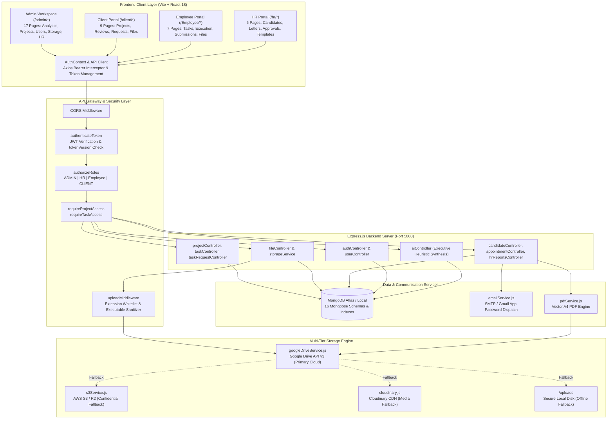
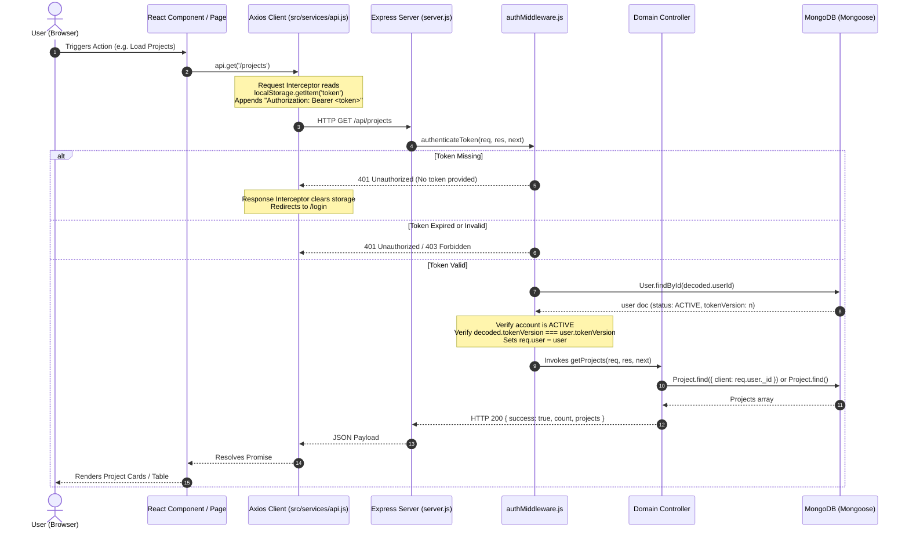
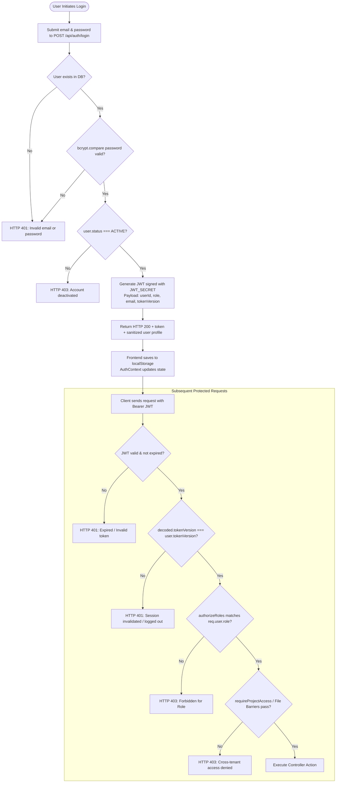
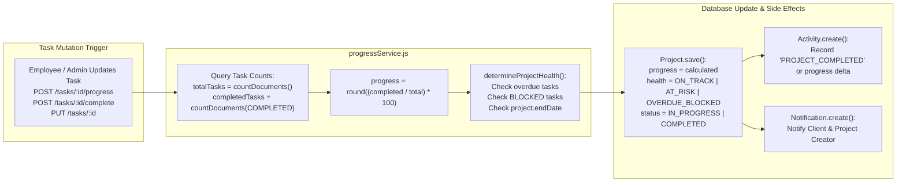
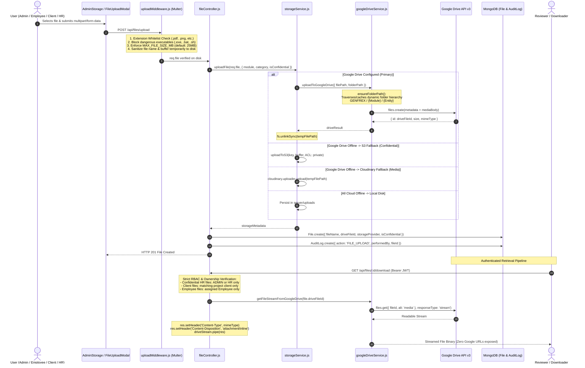

# System Architecture — ClientFlow & GENFREX Platform

## 1. Executive Summary

**ClientFlow** is a modern, full-stack collaborative client portal and business operations management platform. As implemented in this codebase, the application has evolved into the **GENFREX Unified Business Management Platform**, which couples two primary operational engines:

1. **ClientFlow Subsystem**: Client engagement, project stage management, milestones, granular task boards, client task requests, deliverable review/approval flows, threaded discussions, real-time activity audits, and AI project intelligence synthesis.
2. **HR OfferFlow Subsystem**: End-to-end recruitment lifecycle, candidate management, automated Trainee/Intern/Full-Time appointment letter generation via PDFKit, two-tier approval workflows, multi-channel email dispatch (Nodemailer), and candidate acceptance tracking.

Both subsystems share a unified **Node.js/Express.js REST API**, **MongoDB Atlas (Mongoose)** document store, and a **multi-tier enterprise cloud storage architecture** primarily backed by the **Google Drive API v3** with fallback to **AWS S3 / Cloudflare R2** and **Cloudinary**.

---

## 2. High-Level System Architecture

---

## 3. Frontend-to-Backend Request Flow

Every network transaction between the React Single Page Application (SPA) and the Express server follows an authenticated, intercepted pipeline:

---

## 4. Authentication and Authorization Architecture

The platform enforces a centralized **Role-Based Access Control (RBAC)** architecture governed by 4 discrete roles:
- `ADMIN`: Unrestricted platform operations, user management, project orchestration, and HR approvals.
- `HR`: Candidate management, appointment letter creation, template management, and HR reporting.
- `Employee`: Task execution, status updates (`IN_PROGRESS`, `BLOCKED`, `IN_REVIEW`), task time tracking, and deliverable submission.
- `CLIENT`: Read-only transparency over assigned projects, task request submissions, and deliverable review (`APPROVED` / `CHANGES_REQUESTED`).

---

## 5. Database CRUD & Project Lifecycle Flow

The database uses MongoDB via Mongoose. All project progress percentages and health states are calculated in real time through event-driven recalculation:

---

## 6. Google Drive & Multi-Cloud Storage File Lifecycle

Files undergo a rigorous security pipeline. No public links are ever generated in Google Drive or S3; all viewing and downloads are proxied through authenticated backend streams:

---

## 7. Cross-Module Lifecycle Flow: ClientFlow ⟷ HR OfferFlow

The system establishes direct cross-module linkages between client project demands and HR staffing workflows:

```mermaid
flowchart TD
    subgraph ClientStage ["1. Client Engagement"]
        C1["Client submits Task Request<br/>(e.g., 'React Senior Engineer Required')"]
        C2["Admin reviews & approves Task Request"]
        C3["System generates Project Task linked to TaskRequest"]
    end

    subgraph HRStage ["2. HR Staffing & OfferFlow"]
        H1["HR creates Candidate in Talent Pool<br/>Linked to projectId, clientId, requirementId"]
        H2["HR drafts Trainee/Intern/Full-Time Appointment Letter<br/>Selects LetterTemplate & auto-calculates compensation"]
        H3["HR submits Appointment Letter for Approval<br/>Status: PENDING_APPROVAL"]
        H4["Admin approves Appointment Letter<br/>Status: APPROVED"]
    end

    subgraph DocumentStage ["3. Automated Document Generation & Dispatch"]
        D1["pdfService.js generates vector 2-page A4 PDF using PDFKit"]
        D2["storageService uploads PDF directly to Google Drive<br/>(Folder: GENFREX / HR / Appointment Letters)"]
        D3["File record & AuditLog created in MongoDB"]
        D4["emailService.js dispatches letter via SMTP with PDF attachment"]
    end

    subgraph OnboardingStage ["4. Acceptance & Staff Assignment"]
        O1["Candidate Accepts Appointment"]
        O2["Candidate converted to Employee account in User collection"]
        O3["Employee assigned to Project assignedEmployees & Task assignedTo"]
    end

    C1 --> C2 --> C3
    C3 -.->|Requirement Link| H1
    H1 --> H2 --> H3 --> H4
    H4 --> D1 --> D2 --> D3 --> D4
    D4 --> O1 --> O2 --> O3
```

---

## 8. Dependency and Integration Map

| Layer | Component / Package | Version | Architectural Role | Status |
|---|---|---|---|---|
| **Frontend Framework** | `react` / `react-dom` | `^18.3.1` | Core reactive UI library | Verified active |
| **Frontend Tooling** | `vite` | `^5.4.3` | Development server and production bundler | Verified active |
| **Frontend Routing** | `react-router-dom` | `^6.26.2` | Client-side routing and role guards | Verified active |
| **HTTP Client** | `axios` | `^1.7.7` | REST API communication with Bearer interceptor | Verified active |
| **Icons & UI** | `lucide-react` | `^0.441.0` | Crisp SVG iconography | Verified active |
| **Analytics Charts** | `recharts` | `^2.12.7` | SVG analytics charts in dashboards | Verified active |
| **Styling** | `tailwindcss` | `^3.4.10` | Utility-first design system | Verified active |
| **Backend Runtime** | Node.js | v18+ | JavaScript server runtime | Verified active |
| **Server Framework**| `express` | `^4.21.2` | REST API HTTP server | Verified active |
| **Database ODM** | `mongoose` | `^8.9.5` | Document modeling and MongoDB connection | Verified active |
| **Authentication** | `jsonwebtoken` / `bcryptjs` | `^9.0.2` / `^2.4.3` | Stateless JWT issuance & bcrypt hashing (10 rounds) | Verified active |
| **Primary Cloud Storage** | `googleapis` (Drive v3) | `^182.0.0` | Dedicated corporate file repository & streaming | Verified active |
| **Secondary Cloud Storage** | `@aws-sdk/client-s3` | `^3.1142.0` | Private object storage for confidential documents | Verified active |
| **Media CDN Storage** | `cloudinary` | `^2.5.1` | Public media and avatar storage | Verified active |
| **File Multipart Engine** | `multer` | `^1.4.5-lts.1` | Temporary streaming disk ingestion | Verified active |
| **PDF Engine** | `pdfkit` | `^0.20.2` | Clean vector 2-page A4 appointment letter generation | Verified active |
| **Email Engine** | `nodemailer` | `^10.0.12` | SMTP email dispatch with attachments | Verified active |
| **Headless Browser** | `puppeteer` | `^25.12.0` | Installed in `package.json` | **Unused / Dead dependency** |

---

## 9. Architectural Verification Matrix

| Architecture Claim | Codebase Evidence | Verification State |
|---|---|---|
| 4-Role RBAC Model (`ADMIN`, `HR`, `Employee`, `CLIENT`) | `server/models/User.js:27`, `server/middleware/authMiddleware.js:67` | **Verified Ground Truth** |
| Single JWT Authentication Barrier | `server/middleware/authMiddleware.js:9-62` | **Verified Ground Truth** |
| Session Invalidation via `tokenVersion` | `server/models/User.js:65`, `server/middleware/authMiddleware.js:41` | **Verified Ground Truth** |
| Google Drive Primary Storage with Zero Public Links | `server/services/googleDriveService.js:229-244`, `server/controllers/fileController.js:632-645` | **Verified Ground Truth** |
| Dynamic Drive Folder Hierarchy with In-Memory Caching | `server/services/googleDriveService.js:6, 140-159` | **Verified Ground Truth** |
| Auto-recalculated Project Progress & Dynamic Health | `server/services/progressService.js:12-88` | **Verified Ground Truth** |
| AI Executive Summary Generation | `server/controllers/aiController.js:11-160` | **Verified Ground Truth** (Rule-based heuristics, no external LLM API) |
| Public Self-Registration Active | `server/controllers/authController.js:105-110` | **Inferred Drift / Disabled** (Returns 403 Forbidden) |
| Automated Database Demo Seeder Active | `server/seed/seed.js:4-21` | **Inferred Drift / Disabled** (Seeding permanently disabled) |
