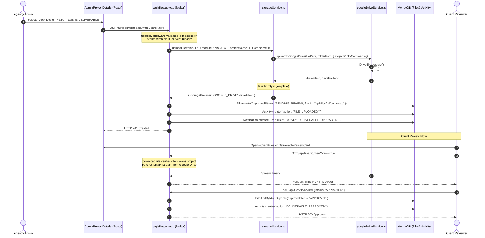

# Storage Integrations — Google Drive & Multi-Cloud Architecture

## 1. Storage Architecture Overview

The **ClientFlow / GENFREX Platform** implements a **four-tier unified cloud storage architecture** designed for enterprise security, multi-cloud resilience, and client privacy.

```text
┌─────────────────────────────────────────────────────────────────────────────┐
│                       Storage Tier Priority Dispatcher                      │
└─────────────────────────────────────────────────────────────────────────────┘
                                       │
        ┌──────────────────────────────┴──────────────────────────────┐
        ▼                                                             ▼
┌────────────────────────────────┐                           ┌────────────────────────────────┐
│   Tier 1: Google Drive API     │                           │      Tier 2: Private AWS S3    │
│   (Primary Enterprise Cloud)   │                           │   (Confidential Document Store)│
│  • googleapis v182             │                           │  • @aws-sdk/client-s3 v3.1142  │
│  • OAuth2 & Service Account    │                           │  • Cloudflare R2 / MinIO       │
│  • Dynamic Folder Hierarchy    │                           │  • 15-min Presigned URLs       │
│  • Zero Public Links           │                           │  • Fallback for Confidential   │
└────────────────────────────────┘                           └────────────────────────────────┘
        │                                                             │
        └──────────────────────────────┬──────────────────────────────┘
                                       ▼
        ┌─────────────────────────────────────────────────────────────┐
        │                 Tier 3: Cloudinary CDN                      │
        │               (Public Media & Avatars)                      │
        │  • cloudinary v2.5.1                                        │
        │  • Fallback for Images and Videos                           │
        └─────────────────────────────────────────────────────────────┘
                                       │
                                       ▼
        ┌─────────────────────────────────────────────────────────────┐
        │              Tier 4: Secure Local Disk                      │
        │                   (Offline Fallback)                        │
        │  • server/uploads directory                                 │
        │  • Authenticated Static Middleware Barrier                  │
        └─────────────────────────────────────────────────────────────┘
```

---

## 2. Integration Status Matrix

| Storage Provider | Implementation Status | Primary Use Case | Backing Service / Config |
|---|---|---|---|
| **Google Drive API v3** | **Fully Implemented** | Primary enterprise cloud storage for all modules (Projects, Deliverables, HR Letters, Employee Files) | `server/services/googleDriveService.js`, `server/services/storageService.js` |
| **AWS S3 / S3-Compatible** | **Fully Implemented** | Secondary confidential document storage fallback (compatible with Cloudflare R2, MinIO, Wasabi) | `server/services/s3Service.js`, `server/config/s3.js` |
| **Cloudinary** | **Fully Implemented** | Secondary public media, image, and avatar storage fallback | `server/config/cloudinary.js`, `server/services/storageService.js` |
| **Secure Local Disk** | **Fully Implemented** | Local offline fallback and temporary multipart upload ingestion | `server/uploads/`, `server/middleware/uploadMiddleware.js`, `server/server.js:43-73` |

---

## 3. Google Drive API Implementation Details

### 3.1 Authentication Mechanisms
The implementation (`server/services/googleDriveService.js:9-80`) natively supports **two server-side authentication strategies**:

1. **OAuth 2.0 Client with Refresh Token (Recommended)**:
   - Configured via environment variables:
     - `GOOGLE_CLIENT_ID`
     - `GOOGLE_CLIENT_SECRET`
     - `GOOGLE_REFRESH_TOKEN`
     - `GOOGLE_REDIRECT_URI` (defaults to `https://developers.google.com/oauthplayground`)
   - Initialized via `new google.auth.OAuth2(...)` and `oauth2Client.setCredentials({ refresh_token })`.
   - Never exposes access tokens or refresh tokens to the frontend client.

2. **Google Cloud Service Account (Alternative)**:
   - Configured via:
     - Key File Path: `GOOGLE_SERVICE_ACCOUNT_KEY_PATH`
     - Raw JSON String: `GOOGLE_SERVICE_ACCOUNT_JSON`
     - Individual Variables: `GOOGLE_SERVICE_ACCOUNT_EMAIL` and `GOOGLE_PRIVATE_KEY` (with automatic `\n` normalization)
   - Initialized via `google.auth.GoogleAuth` or `google.auth.JWT` with scope `https://www.googleapis.com/auth/drive`.

### 3.2 Automated Dynamic Folder Hierarchy
Google Drive folder hierarchy is resolved dynamically on demand (`server/services/googleDriveService.js:140-159` & `server/services/storageService.js:24-65`) and cached in an in-memory `Map` (`folderCache`):

```text
GENFREX (Root Folder: GOOGLE_DRIVE_ROOT_FOLDER_ID)
├── Clients/
│   └── [Client Name]/
│       ├── Documents/
│       └── Projects/
├── Employees/
│   └── [Employee Name]/
├── HR/
│   ├── Candidates/
│   ├── Offer Letters/
│   └── Appointment Letters/
├── Projects/
│   └── [Project Name]/
└── General/
```

- **Traversal Logic**: `ensureFolderPath(pathSegments)` checks the in-memory cache. If absent, it queries `drive.files.list` with query `mimeType = 'application/vnd.google-apps.folder' and name = '...' and trashed = false`. If not found, it calls `drive.files.create` to create the folder.
- **Root Resolution**: If `GOOGLE_DRIVE_ROOT_FOLDER_ID` is not configured, the service dynamically resolves or creates a top-level `GENFREX` folder in the Google Drive root.

### 3.3 Zero Public Link Policy & Streaming Proxy
To prevent unauthorized access or link leaks:
- Files uploaded to Google Drive are **never marked public** (`Anyone with the link can view` is strictly avoided).
- Google Drive file URLs are **never sent to frontend clients**.
- The `File.fileUrl` in MongoDB is populated with the internal proxy URL:
  ```text
  /api/files/:id/download
  ```
- When a user views or downloads a file (`server/controllers/fileController.js:632-645`):
  1. The user authenticates via Bearer JWT.
  2. The server verifies role permissions and tenant boundaries.
  3. The server requests a binary stream from Google Drive via `drive.files.get({ fileId, alt: 'media' }, { responseType: 'stream' })`.
  4. The stream is piped directly into the HTTP response:
     ```javascript
     res.setHeader('Content-Type', mimeType);
     res.setHeader('Content-Disposition', `${isViewOnly ? 'inline' : 'attachment'}; filename="${fileName}"`);
     driveStream.pipe(res);
     ```

### 3.4 Safe File Replacement Flow
File replacement (`server/services/googleDriveService.js:291-305`) guarantees data integrity:
1. The new replacement file is uploaded to Google Drive first.
2. Only after the upload succeeds is the previous Google Drive file deleted via `deleteFileFromGoogleDrive(oldDriveFileId)`.
3. If deletion fails, a warning is logged, but the replacement operation succeeds.

### 3.5 Storage Diagnostics & Quotas
Admin users can view live storage health at `/api/files/storage-stats` (`server/services/googleDriveService.js:310-342`):
- Connects to `drive.about.get({ fields: 'storageQuota, user' })`.
- Returns total Google Drive quota, used bytes, free bytes, account email, and connection status (`CONNECTED`, `STANDBY`, or `ERROR`).

---

## 4. Multi-Tier Fallback Dispatch Logic

When a file upload is triggered via `storageService.uploadFile(file, options)` (`server/services/storageService.js:74-217`), the dispatch sequence evaluates:

```mermaid
flowchart TD
    Start([uploadFile Called]) --> CheckDrive{isGoogleDriveConfigured()?}
    CheckDrive -- Yes --> AttemptDrive[Upload to Google Drive v3 via uploadToGoogleDrive]
    AttemptDrive --> DriveSuccess{Upload Successful?}
    DriveSuccess -- Yes --> CleanTempDrive[fs.unlinkSync temp file] --> ReturnDrive[Return GOOGLE_DRIVE Metadata]
    DriveSuccess -- No --> LogDriveWarn[Log Warning & Continue to Fallback] --> CheckConfidential
    CheckDrive -- No --> CheckConfidential

    CheckConfidential{isConfidential AND isS3Configured?}
    CheckConfidential -- Yes --> AttemptS3[Upload to AWS S3 / R2 with private ACL]
    AttemptS3 --> S3Success{S3 Successful?}
    S3Success -- Yes --> ReturnS3[Return S3 Metadata & s3:// URL]
    S3Success -- No --> LogS3Warn[Log Warning] --> CheckMedia
    CheckConfidential -- No --> CheckMedia

    CheckMedia{isMedia AND isCloudinaryConfigured?}
    CheckMedia -- Yes --> AttemptCloudinary[Upload to Cloudinary CDN]
    AttemptCloudinary --> CloudinarySuccess{Cloudinary Successful?}
    CloudinarySuccess -- Yes --> CleanTempCloud[fs.unlinkSync temp file] --> ReturnCloud[Return CLOUDINARY Metadata & secure_url]
    CloudinarySuccess -- No --> CheckS3General
    CheckMedia -- No --> CheckS3General

    CheckS3General{isS3Configured AND !isMedia?}
    CheckS3General -- Yes --> AttemptS3General[Upload to S3 general bucket]
    AttemptS3General --> ReturnS3General[Return S3 Metadata]
    CheckS3General -- No --> ReturnLocal[Keep in server/uploads & Return LOCAL Metadata]
    AttemptS3General -- No --> ReturnLocal
```

---

## 5. End-to-End File Lifecycle Trace

### Trace: Client Deliverable Upload & Client Review



---

## 6. Enterprise Security & Access Barriers

1. **File Type Whitelist (`server/middleware/uploadMiddleware.js:41-48`)**:
   - Allowed Documents: `.pdf`, `.doc`, `.docx`, `.xls`, `.xlsx`, `.ppt`, `.pptx`, `.txt`, `.csv`, `.rtf`, `.odt`, `.md`
   - Allowed Images: `.jpg`, `.jpeg`, `.png`, `.webp`, `.svg`, `.gif`, `.ico`, `.bmp`, `.tiff`
   - Allowed Archives: `.zip`, `.tar`, `.gz`, `.7z`, `.rar`, `.fig`, `.psd`, `.ai`, `.xd`, `.mp4`
   - **Dangerous Extension Blacklist (`server/middleware/uploadMiddleware.js:34-38`)**:
     - Explicitly rejects: `.exe`, `.bat`, `.cmd`, `.sh`, `.bash`, `.php`, `.cgi`, `.pl`, `.jsp`, `.asp`, `.aspx`, `.vbs`, `.scr`, `.jar`, `.msi`, `.dll`, `.bin`, `.apk`, etc.

2. **File Size Enforcement**:
   - Maximum upload size constrained to `MAX_FILE_SIZE_MB` (defaults to 25MB).

3. **Tenant & Role-Based Download Barriers (`server/controllers/fileController.js:458-600`)**:
   - **HR Confidential Barrier**: Files marked `isConfidential` or belonging to `HR` module trigger a `403 Forbidden` if requested by `CLIENT` or `Employee`. An audit log entry `FILE_ACCESS_DENIED` is generated.
   - **Client Tenant Barrier**: Clients attempting to access files from other client projects receive `403 Forbidden` (`CROSS_PROJECT_CLIENT_BARRIER`).
   - **Employee Project Barrier**: Employees attempting to access files for unassigned projects receive `403 Forbidden` (`Employee_UNASSIGNED_PROJECT`).
   - **Internal Task Barrier**: Files attached to tasks where `clientVisible === false` are concealed from clients.

4. **Static Directory Guard (`server/server.js:43-73`)**:
   - The `/uploads` static route is wrapped with `authenticateToken` and custom RBAC logic to prevent unauthenticated direct URL access to disk files.

5. **Storage Audit Trail (`server/models/AuditLog.js:30-36`)**:
   - Records every `FILE_UPLOAD`, `FILE_VIEW`, `FILE_DOWNLOAD`, `FILE_DELETE`, `FILE_REPLACE`, and `FILE_ACCESS_DENIED` event with actor ID, IP/role, timestamp, and target file metadata.
